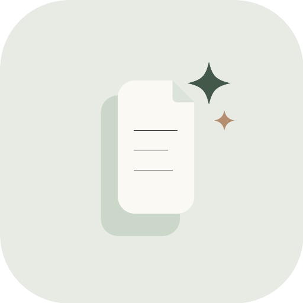
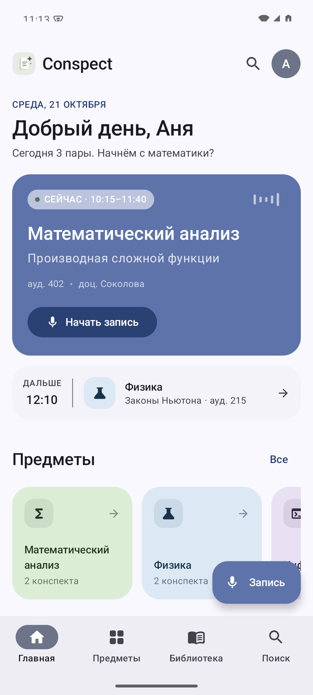
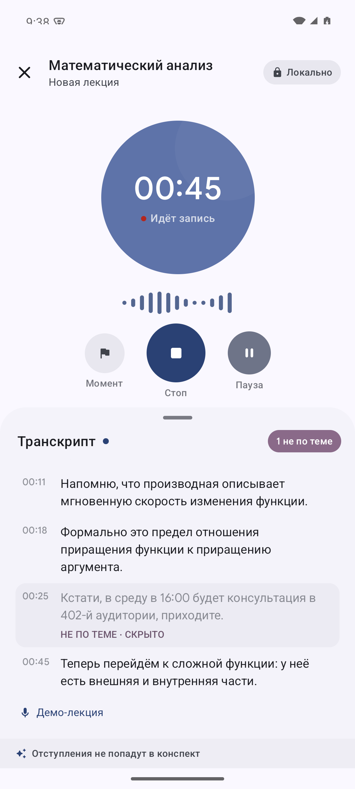
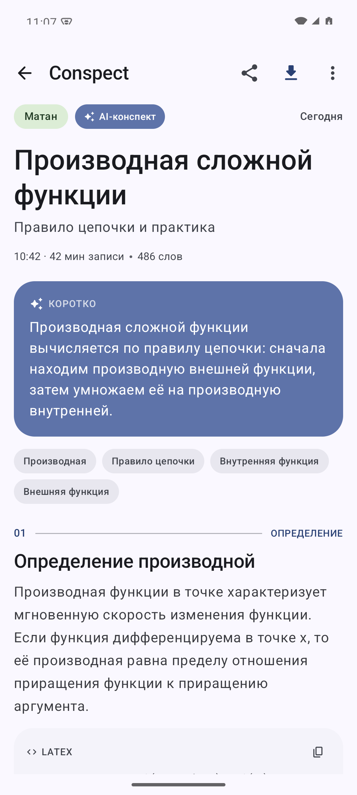

# Conspect

Нативное Android-приложение для конспектов. Записываете лекцию — Conspect распознаёт речь, убирает отступления и собирает структурированный конспект с формулами LaTeX.

**[Скачать APK](https://github.com/skibidius/conspect/releases/latest)** · **[Сайт](https://skibidius.github.io/conspect/)** · **[Поддержать](https://pay.cloudtips.ru/p/b5d67e09)**

<p align="center">
  
  
  
</p>

## Что умеет

- Распознавание речи: системный движок Android или Sherpa GigaAM офлайн (~230 МБ).
- Sherpa GigaAM работает офлайн; системный движок Android может использовать сервис Google. DeepSeek Flash — опционально по API-ключу.
- Конспекты с LaTeX-формулами, поиск, предметы и библиотека. Экспорт в PDF A4 — когда нужен файл; текст в PDF можно выделять и копировать.
- 18 иконок для предметов и свободный выбор цветов.
- Импорт аудио из другого приложения: m4a, mp3, wav, ogg и webm/opus.
- Резервная копия данных: экспорт и импорт предметов, конспектов и настроек.
- Понятный прогресс импорта: этап, обработанное время, длительность лекции и оставшееся время.
- Импорт продолжается при повороте экрана и после возврата назад; прогресс остаётся в нижней панели.
- Раздел «О приложении» с открытыми лицензиями используемых библиотек и моделей.
- Свайп по лекции: влево — в корзину, вправо — поделиться PDF. Удалённое можно вернуть из снекбара.
- Долгое нажатие — выбор нескольких лекций и общий экспорт PDF или удаление.
- Перед записью приложение проверяет доступ к микрофону и предлагает открыть настройки, если доступ запрещён.
- Удаление предметов долгим нажатием с подтверждением.

Приложение стартует пустым: добавьте предметы и записывайте лекции.

## Сборка

```bash
./gradlew :app:assembleDebug
```

JDK 21, Android SDK 36.

Материалы для RuStore (иконка, скриншоты 16:9 и тексты карточки): `docs/rustore/`.
